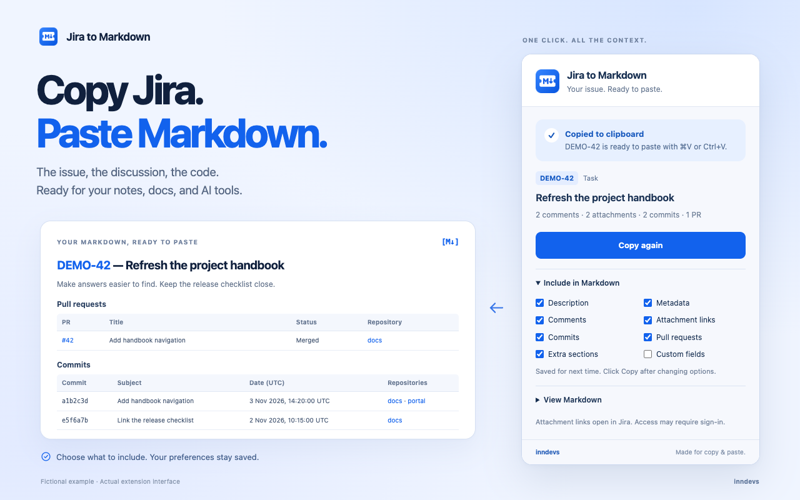

# Jira to Markdown

**[Install from the Chrome Web Store](https://chromewebstore.google.com/detail/bnlaogkehajaoilnnhamjebnmgiihncm)**

Click the extension on an HTTPS Jira issue to copy it as Markdown. Choose which details to include, then click **Copy Markdown** to update the clipboard. Options are saved locally; **View Markdown** shows the output.

Commits and pull requests appear in compact tables with repository links. Repeated commit hashes are combined across repositories; full messages, authors, and PR branches remain available in expandable sections. Readable dates, linked issue keys, and clear acceptance criteria keep the export easy to scan. Each content option is saved locally. Warnings flag partial results.



Uses your Jira session. If the API is unavailable, it copies visible page content and warns about missing details. Attachments remain links requiring Jira access.

## Install from source

```sh
git clone https://github.com/inndevs/jira-ticket-copy-as-markdown.git
```

Open `chrome://extensions`, enable **Developer mode**, select **Load unpacked**, and choose the cloned folder. No build or dependencies required.

## Develop

```sh
npm test
npm run test:browser
npm run package
node scripts/render-store-assets.mjs
node scripts/render-icons.mjs
```

Requires Node.js, Python 3, and Chrome. Set `CHROME_BIN` for a custom Chrome location. Browser tests and screenshots use isolated profiles and fictional data. Reload the extension after edits. The package is written to `dist/`.

## Privacy and support

Issue data stays in your browser and clipboard. Only preferences are stored. Permissions: `activeTab` and `scripting` read the selected issue; `storage` saves options; `clipboardWrite` copies Markdown. See [Privacy](PRIVACY.md).

[Report issues](https://github.com/inndevs/jira-ticket-copy-as-markdown/issues) without private Jira data. Independent extension by [inndevs](https://github.com/inndevs), unaffiliated with Atlassian. [MIT License](LICENSE).
